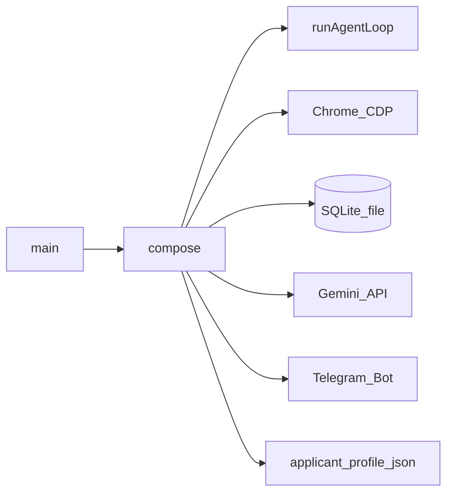
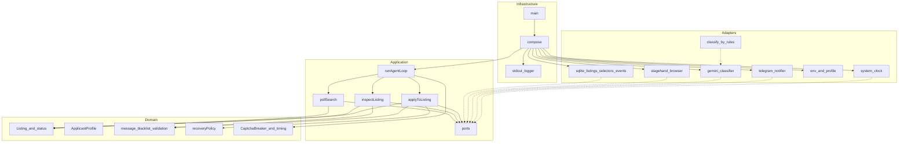

# Architecture

Mermaid source in this file is the module map. When a use case, port, or adapter is added or removed, update the diagrams in the same change.

The process never launches Chrome. It attaches to the debugging port, and only `compose` knows about Stagehand, SQLite, Gemini, and Telegram.

Arrows in the module diagram are source dependencies. They point inward. Adapters implement ports; they do not sit inside the use cases. Domain has no framework imports.

Use cases in [src/application](../src/application): `poll-search`, `inspect-listing`, `apply-to-listing`, `run-agent-loop`. Ports live beside them: listings, selector cache, events, browser session, failure classifier, notifier, control channel, clock, logger.

Domain rules stay in [src/domain](../src/domain): listing transitions, message rendering, blacklist, validation-field matching, recovery policy, captcha breaker, active hours.

Concrete edges stay in [src/adapters](../src/adapters) and are wired only by [src/infrastructure/compose.ts](../src/infrastructure/compose.ts).
