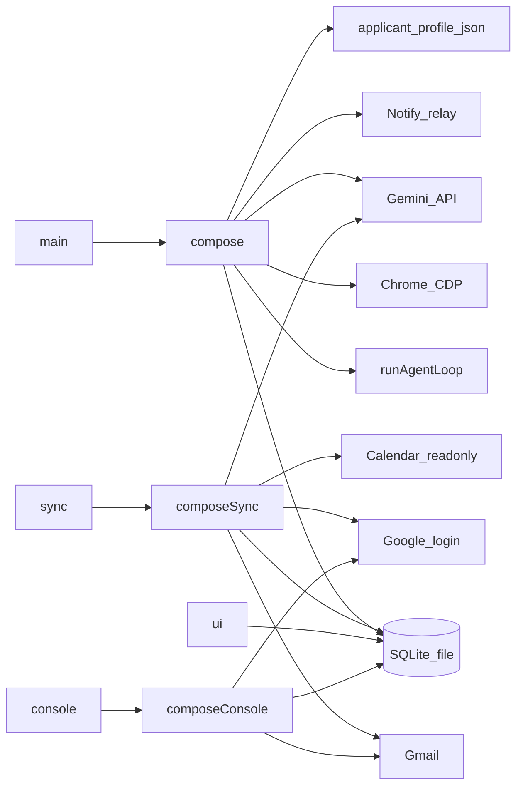

# Architecture

Mermaid source in this file is the module map. When a use case, port, or adapter is added or removed, update the diagrams in the same change. When the operator-visible order of a run changes, update [flows.md](flows.md) in the same change.

The apply process never launches Chrome. It attaches to the debugging port, and only `compose` knows about Stagehand, SQLite, Gemini, and the notify service. That service is the Worker `wohn-notify`, outside this repo, at `https://wohn-notify.shinnenkara.workers.dev`. `compose` calls it over HTTP when `data/notify.json` exists.

Mail and calendar sync is a separate process. Only `compose-sync` knows about Gmail, Calendar, Gemini, and the Google login Worker. That Worker is `wohn-google`, outside this repo, at `https://wohn-google.shinnenkara.workers.dev`. `compose-sync` asks it for an access token when `data/google.json` exists. `npm run sync` reads once. `npm run sync --watch` repeats that read every 15 seconds and does not attach to Chrome. Sync turns actionable intents into `user_mail_actions` and leaves receipts, wait notes, and rejections out of that queue. A confirmation or rejection closes earlier pending tasks for the same apartment. The progress page reads SQLite, can enqueue an expose refresh, and can link an unresolved mail to an apartment. It does not attach to Chrome. The agent performs an expose read on its next tick. `npm run console` reads the same queue. It opens a booking link or creates a Gmail draft, and it does not send mail. A later slice can add `MailSender` and `CalendarWriter` behind a confirmation step. Those ports are not in this tree.

Arrows in the module diagram are source dependencies. They point inward. Adapters implement ports; they do not sit inside the use cases. Domain has no framework imports.

```mermaid
flowchart TB
  subgraph infrastructure [Infrastructure]
    mainNode[main]
    composeNode[compose]
    syncNode[sync_and_login]
    uiNode[ui]
    consoleNode[console]
    loggerImpl[stdout_logger]
  end

  subgraph adapters [Adapters]
    sqliteRepos[sqlite_listings_progress_mail]
    browser[stagehand_browser]
    googleAd[gmail_calendar_clients]
    rules[classify_by_rules]
    geminiClf[gemini_classifier]
    notifyAd[notify_notifiers]
    configAd[env_and_profile]
    clockAd[system_clock]
  end

  subgraph application [Application]
    runLoop[runAgentLoop]
    poll[pollSearch]
    inspect[inspectListing]
    apply[applyToListing]
    syncInbox[syncInbox]
    readExpose[readExpose]
    refreshExpose[refreshExpose]
    ports[ports]
  end

  subgraph domain [Domain]
    listing[Listing_and_status]
    progress[Funnel_progress]
    scoutMail[Scout_mail_and_citations]
    mailLink[Quote_strip_and_mail_link]
    triage[Triage_and_firewall]
    mailActions[Mail_action_queue]
    profileDom[ApplicantProfile]
    template[message_blacklist_validation]
    recovery[recoveryPolicy]
    breaker[CaptchaBreaker_and_timing]
  end

  mainNode --> composeNode
  syncNode --> googleAd
  syncNode --> sqliteRepos
  uiNode --> sqliteRepos
  consoleNode --> sqliteRepos
  consoleNode --> googleAd
  composeNode --> runLoop
  composeNode --> sqliteRepos
  composeNode --> browser
  composeNode --> geminiClf
  composeNode --> notifyAd
  composeNode --> configAd
  composeNode --> clockAd
  composeNode --> loggerImpl

  runLoop --> poll
  runLoop --> inspect
  runLoop --> apply
  poll --> ports
  inspect --> ports
  apply --> ports
  syncInbox --> ports
  readExpose --> ports
  refreshExpose --> readExpose
  refreshExpose --> ports
  inspect --> readExpose
  runLoop --> refreshExpose
  poll --> listing
  poll --> progress
  inspect --> listing
  inspect --> template
  inspect --> progress
  apply --> listing
  apply --> template
  apply --> recovery
  apply --> progress
  syncInbox --> progress
  syncInbox --> scoutMail
  syncInbox --> mailLink
  syncInbox --> triage
  syncInbox --> mailActions
  runLoop --> breaker

  sqliteRepos -.-> ports
  browser -.-> ports
  googleAd -.-> ports
  geminiClf -.-> ports
  rules -.-> geminiClf
  notifyAd -.-> ports
  clockAd -.-> ports
```

Use cases in [src/application](../src/application): `poll-search`, `inspect-listing`, `apply-to-listing`, `run-agent-loop`, `sync-inbox`, `read-expose`, `refresh-expose`, `assign-mail`, `materialize-actions`. Ports live beside them: listings, progress, mail, mailbox, agenda, account, selector cache, events, browser session, failure classifier, mail reader, mail resolver, notifier, draft writer, control channel, clock, logger, expose refresh.

Domain rules stay in [src/domain](../src/domain): listing transitions, funnel stages, scout mail parsing, quote stripping, mail linking, citation checks, reply drafts, mail triage and the DSGVO firewall, the action queue and its supersede rules, message rendering, blacklist, validation-field matching, recovery policy, captcha breaker, active hours.

Concrete edges stay in [src/adapters](../src/adapters) and are wired only by [src/infrastructure/compose.ts](../src/infrastructure/compose.ts), [src/infrastructure/compose-sync.ts](../src/infrastructure/compose-sync.ts), and [src/infrastructure/compose-console.ts](../src/infrastructure/compose-console.ts). The progress page is [src/infrastructure/ui-main.ts](../src/infrastructure/ui-main.ts). The console is [src/infrastructure/console-main.ts](../src/infrastructure/console-main.ts). The Google OAuth client lives on the `wohn-google` Worker. This repo keeps the Gmail and Calendar clients, and the device token in `data/google.json`. Draft creation uses `gmail.compose` on that same login.
