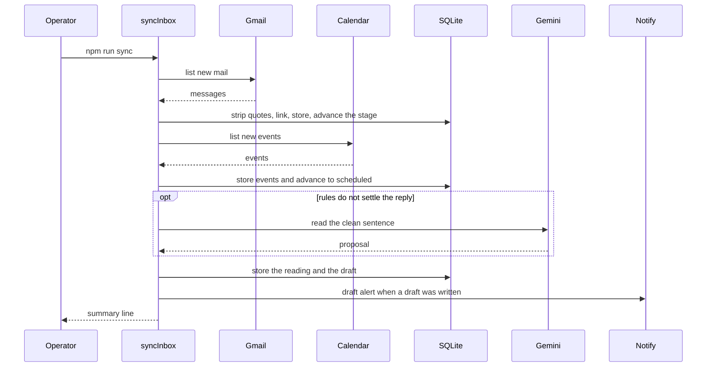
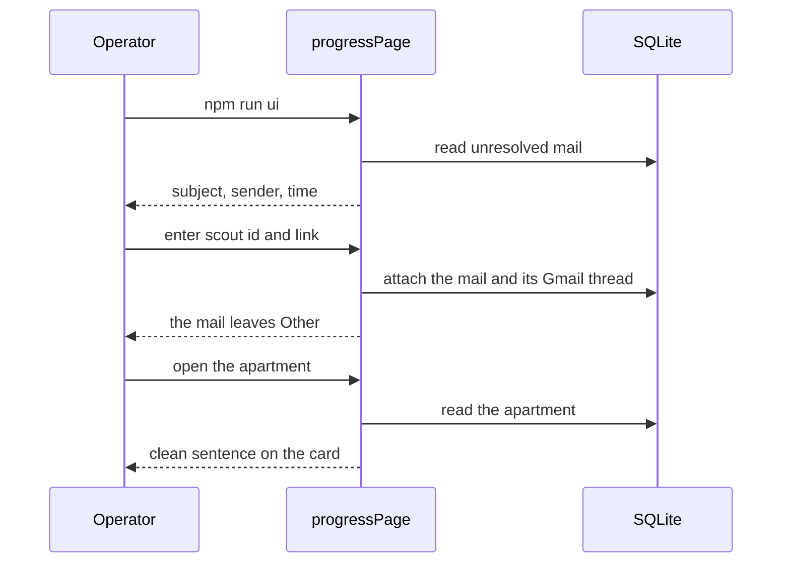

# Flows

Mermaid source in this file is the operator-visible order of a run. When that order changes for `npm run dev`, `npm run sync`, or `npm run ui`, update these diagrams in the same change. A refactor that keeps the order leaves this file as it is. The module map is in [architecture.md](architecture.md).

Login and Telegram linking set up credentials. They are not a result of a run, so they are not stories here.

## An application goes out

As the operator, I run the loop so a new listing from a saved search is contacted. I see `application sent` in the log, the listing leaves `DISCOVERED`, and Telegram receives the alert when this machine is linked.

One tick, one new listing, send confirmed:

```mermaid
sequenceDiagram
  participant Operator
  participant Loop as runAgentLoop
  participant Chrome
  participant SQLite
  participant Notify
  Operator->>Loop: npm run dev
  Loop->>Chrome: attach and confirm login
  Loop->>Chrome: open saved search
  Chrome-->>Loop: listing cards
  Loop->>SQLite: insert new DISCOVERED
  Loop->>Chrome: read expose, open contact form, fill, send
  Chrome-->>Loop: success text
  Loop->>SQLite: mark APPLIED
  Loop-->>Operator: application sent
  Loop->>Notify: alert when linked
```

The same tick drains one expose refresh queued from the progress page before it polls. That path is in the next story.

Other outcomes the operator can see:

- The log says the debugging port is unavailable, or that the loop is waiting for an ImmoScout login. The login wait sends one `SESSION_EXPIRED` alert.
- Outside 07:00–23:00 Europe/Berlin the loop sleeps until 07:00, unless `OVERNIGHT_RUN=true`.
- A captcha pauses the loop and sends `CAPTCHA_OPEN`.
- A blacklist keyword sets `FILTERED_OUT` and does not open the form. An external portal, or a form the agent cannot complete, sets manual and sends `MANUAL_REQUIRED`.
- `DRY_RUN=true` prints the application and leaves the listing `DISCOVERED`.
- A failed send sets `FAILED` and is not retried.

## Landlord mail moves the apartment

As the operator, I run sync so new mail and calendar events move apartments along the funnel. The terminal prints how many messages and events were stored, how many apartments advanced, how many were read, how many drafts were written, and how many messages are still waiting. I then open the progress page and see that stage.



Each message is stored. A linked landlord or portal mail moves the apartment to `in_conversation`. A message that does not match an apartment is stored with an empty scout id and does not move a stage. Linking tries the expose id, the Gmail thread, `References`, then a unique street plus zip or street plus cold rent. When those miss and a model key is set, Gemini may pick one open apartment from the last 14 days. Rules that settle a reply do not call Gemini for the draft. Gemini reads at most five messages in one run, and that cap includes listing picks. Telegram gets the draft when a reply body was written and this machine is linked. Without `data/google.json`, sync stops and says to run `npm run login`.

`npm run sync --watch` repeats this sequence every 15 seconds. A tick that stored nothing prints nothing. A tick that stored mail, stored an event, advanced a stage, or wrote a draft prints the summary line.

The progress page reads that database. It does not attach to Chrome. When a listing has no expose facts, Read expose queues a refresh, and the next agent tick fills it.

```mermaid
sequenceDiagram
  participant Operator
  participant Ui as progressPage
  participant SQLite
  participant Loop as runAgentLoop
  participant Chrome
  Operator->>Ui: npm run ui
  Ui->>SQLite: read stages and apartments
  Ui-->>Operator: funnel
  Operator->>Ui: Read expose
  Ui->>SQLite: enqueue refresh
  Ui-->>Operator: Waiting to read the expose
  Note over Loop,Chrome: next npm run dev tick
  Loop->>SQLite: take the queued refresh
  Loop->>Chrome: read the expose
  Loop->>SQLite: save facts and finish the queue
  Operator->>Ui: open the apartment again
  Ui->>SQLite: read the apartment
  Ui-->>Operator: expose facts
```

Without a database, the page tells the operator to run `npm run dev` or `npm run sync` first. Read expose on a listing that already has facts says so and does not queue. A failed refresh shows the failure on the card.

## An unresolved mail gets a home

As the operator, I open the Other tab when a mail did not match an apartment. I see the subject, the sender, and the time. I enter the scout id and the page attaches that mail to the apartment. The mail leaves Other. On the apartment card I see the new sentence, above any quoted history that stayed in the archive.



An unknown scout id is rejected and the row stays on Other. The funnel and Read expose are unchanged.
