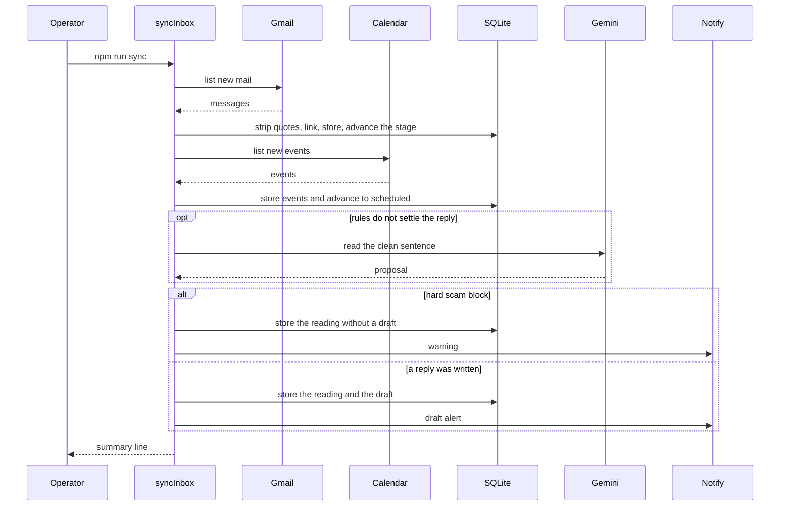
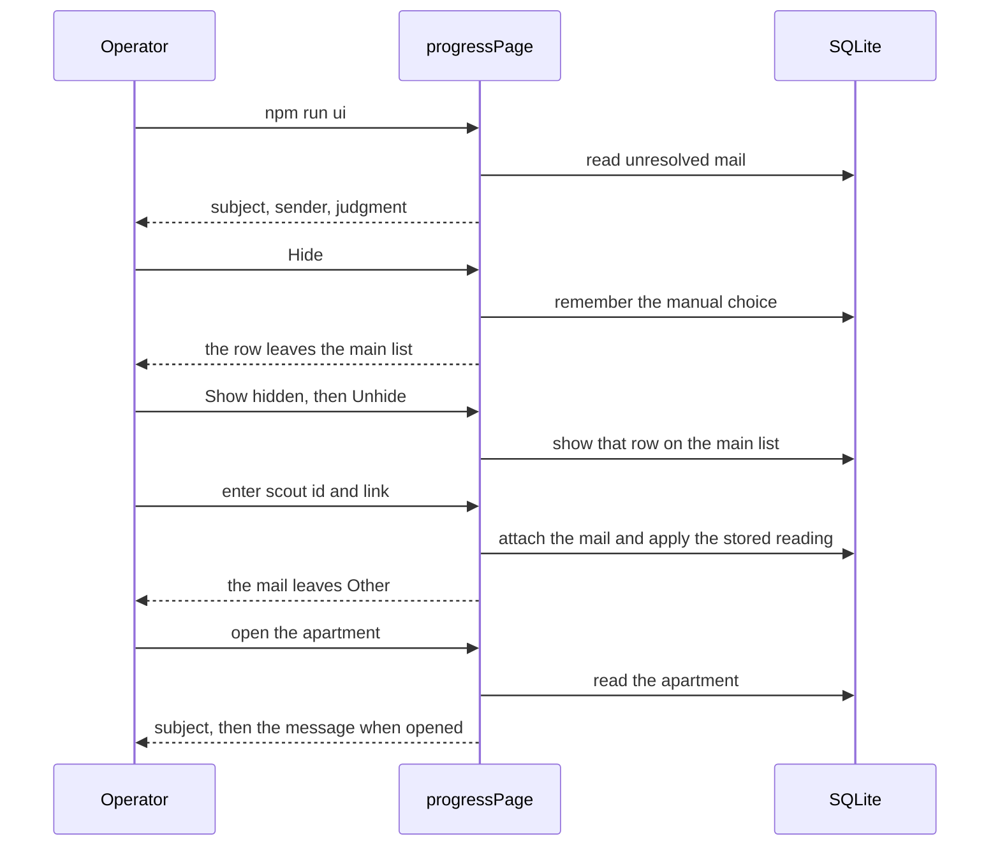
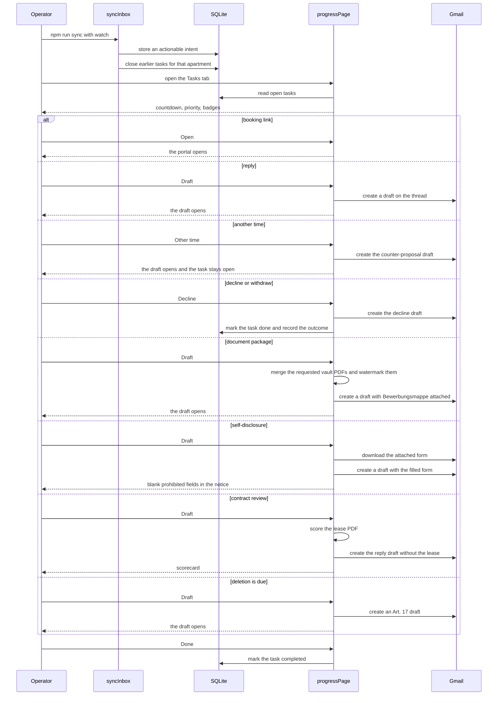

# Flows

Mermaid source in this file is the operator-visible order of a run. When that order changes for `npm run dev`, `npm run sync`, or `npm run ui`, update these diagrams in the same change. A refactor that keeps the order leaves this file as it is. The module map is in [architecture.md](architecture.md).

Login and Telegram linking set up credentials. They are not a result of a run, so they are not stories here.

## An application goes out

As the operator, I run the loop so a new listing from a saved search is contacted. I see `application sent` in the log, the listing leaves `DISCOVERED`, and Telegram receives the alert when this machine is linked.

One tick, one new listing, send confirmed:

```mermaid
sequenceDiagram
  participant Operator
  participant Loop as runAgentLoop
  participant Chrome
  participant SQLite
  participant Notify
  Operator->>Loop: npm run dev
  Loop->>Chrome: attach and confirm login
  Loop->>Chrome: open saved search
  Chrome-->>Loop: listing cards
  Loop->>SQLite: insert new DISCOVERED
  Loop->>Chrome: read expose, open contact form, fill, send
  Chrome-->>Loop: success text
  Loop->>SQLite: mark APPLIED
  Loop-->>Operator: application sent
  Loop->>Notify: alert when linked
```

The same tick drains one expose refresh queued from the progress page before it polls. That path is in the next story.

Other outcomes the operator can see:

- The log says the debugging port is unavailable, or that the loop is waiting for an ImmoScout login. The login wait sends one `SESSION_EXPIRED` alert.
- Outside 07:00–23:00 Europe/Berlin the loop sleeps until 07:00, unless `OVERNIGHT_RUN=true`.
- A captcha pauses the loop and sends `CAPTCHA_OPEN`.
- A blacklist keyword sets `FILTERED_OUT` and does not open the form. An external portal, or a form the agent cannot complete, sets manual and sends `MANUAL_REQUIRED`.
- `DRY_RUN=true` prints the application and leaves the listing `DISCOVERED`.
- A failed send sets `FAILED` and is not retried.

## Landlord mail moves the apartment

As the operator, I run sync so new mail and calendar events move apartments along the funnel. The terminal prints how many messages and events were stored, how many apartments advanced, how many were read, how many drafts were written, and how many messages are still waiting. I then open the progress page and see that stage.



Each message is stored. A linked landlord or portal mail moves the apartment to `in_conversation`. A message that does not match an apartment is stored with an empty scout id and does not move a stage. Linking tries the expose id, the Gmail thread, `References`, then a unique street plus zip or street plus cold rent. When those miss and a model key is set, Gemini may pick one open apartment from the last 14 days. That pick returns an id or nothing. It does not return a confidence. Rules that settle a pure receipt, wait note, or quoted rejection do not call Gemini. A mail that also carries a link, a date, a document request, or a payment phrase still does. Gemini reads at most five messages in one run, and that cap includes listing picks. Unlinked mail from ImmoScout, a message copy, the connected account, or a street hit on an open apartment is read before the rest of the inbox. Gemini also says whether the message is `unrelated` or `possible`. A cited housing intent stays `possible` even when the model said unrelated. Intent confidence is stored on the intent and is not a cutoff. Mail sent from the connected account is read as the operator's own message and does not get a reply draft. Telegram gets the draft when a reply body was written for a critical or high-priority intent and this machine is linked. A hard scam block skips that draft and does not advance the apartment from the reading; Telegram gets a warning instead. A portal link with nothing to reply to sends the same kind of alert. Receipts, wait notes, and rejections stay on the card and do not alert. Without `data/google.json`, sync stops and says to run `npm run login`.

`npm run sync --watch` repeats this sequence every 15 seconds. A tick that stored nothing prints nothing. A tick that stored mail, stored an event, advanced a stage, or wrote a draft prints the summary line.

A portal receipt that confirms our own cancellation (`Ihre Absage`, `Besichtigungstermin abgesagt`), and a sent mail in which we cancel the appointment, stores no reply. The apartment leaves the active funnel with outcome `cancelled_by_us`, and open appointment tasks for it are closed. A landlord note that only the slot is off (`Termin entfällt`) stays in the funnel and drafts a request for a new time. An apartment that is already rented stays on the rejection path and leaves the funnel as `rejected`. A later viewing or contract mail reopens only `cancelled_by_us`. A calendar event Google reports as cancelled is removed from the apartment card and does not set an outcome.

The progress page reads that database. It does not attach to Chrome. Opening the page lists every apartment. `?stage=` limits that list to the selected branch and every stage under it. `?stage=discovered` lists every open apartment. `?stage=closed` lists apartments that left the funnel. `#` plus the scout id scrolls to that card. When a listing has no expose facts, Read expose queues a refresh, and the next agent tick fills it. Each funnel band counts apartments that reached that stage and are still open, including those further down the same branch. A Closed column lists the ones that were cancelled, rejected, declined, or withdrawn.

```mermaid
sequenceDiagram
  participant Operator
  participant Ui as progressPage
  participant SQLite
  participant Loop as runAgentLoop
  participant Chrome
  Operator->>Ui: npm run ui
  Ui->>SQLite: read stages and apartments
  Ui-->>Operator: funnel
  Operator->>Ui: Read expose
  Ui->>SQLite: enqueue refresh
  Ui-->>Operator: Waiting to read the expose
  Note over Loop,Chrome: next npm run dev tick
  Loop->>SQLite: take the queued refresh
  Loop->>Chrome: read the expose
  Loop->>SQLite: save facts and finish the queue
  Operator->>Ui: open the apartment again
  Ui->>SQLite: read the apartment
  Ui-->>Operator: expose facts
```

Without a database, the page tells the operator to run `npm run dev` or `npm run sync` first. Read expose on a listing that already has facts says so and does not queue. A failed refresh shows the failure on the card.

## An unresolved mail gets a home

As the operator, I open the Other tab when a mail did not match an apartment. I see the subject, the sender, the time, and the reading: `possible` or `unrelated`, the intent, its summary, and its confidence. A mail that has not been read yet says `Not read yet`. An explicit unrelated reading with no cited housing intent is hidden. Hide removes any row from the main list, including one that has not been read yet. Show hidden lists every unlinked mail. Unhide puts that row back on the main list, including one the reader called unrelated. I enter the scout id and the page attaches that mail to the apartment and applies the stored reading. The mail leaves Other. On the apartment card I see the subject. I open the message to read the new sentence. Quoted history stays in the archive. A task from that reading appears after the link.



An unknown scout id is rejected and the row stays on Other. A mail that is not read yet, or whose reading failed, stays visible and is tried again on a later sync. The funnel and Read expose are unchanged.

## An open task is handled from the progress page

As the operator, I open the Tasks tab while sync is watching. I see only tasks that need a decision, soonest deadline first. The tab shows how many are open and refreshes about once a second. A new urgent task shows a banner. A receipt, a wait note, a rejection, or our own cancellation receipt does not appear. When a confirmation, a rejection, our cancellation, or a cancelled slot arrives for an apartment, earlier tasks for that apartment leave the list. I use Open for a booking link and Draft for the yes reply. On a viewing proposal, a confirmation, or a signing time I also get Other time and Decline. Other time proposes different evenings, or asks for other times when the calendar has none. Decline writes “Bitte sagen Sie den Termin ab.”, marks the task done, and sets `cancelled_by_us`. After a viewing, Withdraw drops the application. On a contract offer, Decline refuses the contract and sets `offer_declined`. I send the draft myself.



Open opens the portal link when the mail has one, and the Gmail message otherwise. Draft leaves the task unchanged when it has no reply text, or when Gmail refuses the draft; the page shows the reason. On Send documents, Draft attaches only the requested vault files, watermarked for that landlord and address. A missing file stops the draft. A document requested before a viewing is left out and named in the notice. On Send self-disclosure, Draft fills the attached PDF and leaves marital status, religion, ethnic origin, pregnancy, and previous-landlord fields blank. On Review contract, Draft shows the scorecard and drafts the existing reply with no lease attached. A deletion task stays off the list for 30 days after the document send, then Draft stages an Art. 17 letter with no attachment. Scam asks for confirmation, then marks the apartment so later mail does not enqueue it. A WBM sender shows a `WBM` badge. A proposed time that overlaps a synced calendar event shows `CONFLICT`. The page does not attach to Chrome and does not send mail. Without a database it tells the operator to run `npm run dev` or `npm run sync` first.
